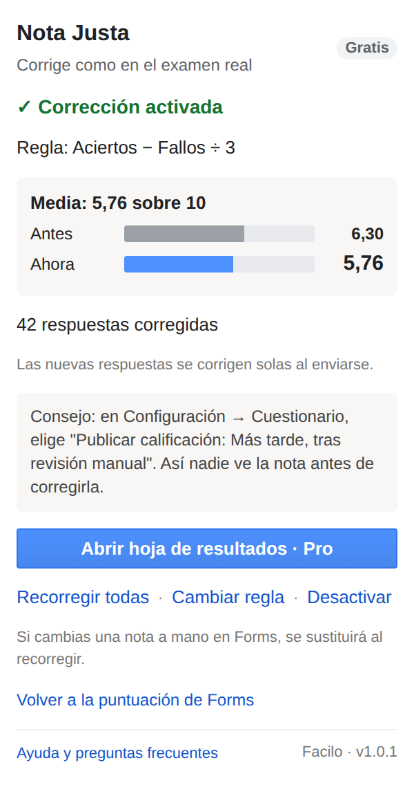
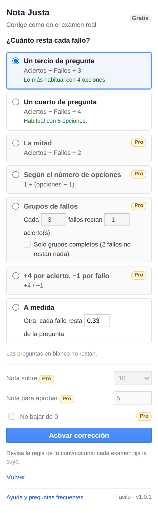

# Nota Justa para Google Forms

**La nota real de tus tests de Google Forms.** Google Forms no resta los fallos: un fallo vale 0, igual que una pregunta en blanco. Nota Justa vuelve a puntuar el cuestionario con la penalización de tu examen (−1/3, −1/4 o tu propia regla) y escribe la nota corregida en Forms, para que tus alumnos vean su nota real sobre 10 cuando publicas las calificaciones.

Web, instalación y ayuda: **https://notajusta.facilo.es**

## Para quién es

- Academias y preparadores de oposiciones que hacen simulacros en Google Forms.
- Profesores de colegio, FP y universidad que ponen exámenes tipo test.
- Cualquiera que necesite que cada fallo reste, como en el examen de verdad.

## Cómo se usa, en 3 pasos

1. Copia los dos archivos desde https://notajusta.facilo.es/instalar/ (o desde `dist/` aquí) en Extensiones → Apps Script de tu cuestionario. Google pide un permiso la primera vez.
2. Abre Nota Justa en el menú de complementos y elige cuánto resta cada fallo.
3. Pulsa Activar corrección. Las respuestas que ya tienes se recorrigen y las nuevas se corrigen solas al enviarse.

## Lo que no hace

- No crea el cuestionario ni las preguntas: trabaja sobre un cuestionario de Forms que ya tienes.
- No está en Google Workspace Marketplace: se instala pegando el código, un formulario cada vez.
- Las preguntas de cuadrícula se cuentan solo en la hoja de resultados (Pro), porque Forms no deja cambiar su puntuación.

## Gratis y Pro

- **Gratis**, sin límite de respuestas ni de formularios: un tercio, un cuarto o tu propia regla, nota sobre 10.
- **Pro** (29 € al año o 4 € al mes): además la mitad, según el número de opciones, grupos de fallos y +4/−1; nota sobre la escala que quieras, nota de aprobado, no bajar de 0, y una hoja de resultados con aciertos, fallos, en blanco, nota, aprobado, puesto y las preguntas que más falla el grupo.
- **Academia** (79 € al año): Pro para 20 profesores.

## Privacidad

Nota Justa funciona dentro de tu cuenta de Google. Solo lee el formulario donde lo instalas y la hoja de resultados que crea, y tus respuestas no salen de Google. Detalles: https://notajusta.facilo.es/privacidad/

---

# Nota Justa for Google Forms (English)

**Negative marking for Google Forms quizzes.** Google Forms can't subtract marks for wrong answers. Nota Justa rescores the quiz with your rule and writes the real score back to Forms, so students see it when you release grades.

- **Who it's for:** teachers and test-prep trainers who run multiple-choice quizzes in Google Forms.
- **How to use it:** 1) paste the two files from https://notajusta.facilo.es/en/install/ into Extensions → Apps Script; 2) open Nota Justa and pick how much a wrong answer takes off; 3) click Activate. Existing responses are rescored and new ones are marked as they arrive.
- **What it doesn't do:** it doesn't build the quiz for you, it isn't on the Workspace Marketplace (you paste it in), and grid questions are counted only in the Pro results sheet.
- **Free**, no response limit: −1/3, −1/4 or your own rule, mark out of 10. **Pro** adds −1/2, by number of options, groups of wrong answers, +4/−1, any scale, pass mark, and the results sheet with ranking and most-missed questions.

## Files

- `dist/nota-justa.gs`: the add-on, exactly the file served at https://notajusta.facilo.es/assets/nota-justa.gs.txt (version 1.0.1).
- `dist/appsscript.json`: the manifest with the permissions it asks for.
- `SECURITY.md`: how to report a security problem, and the support period.
- `sbom.cdx.json`: software bill of materials (CycloneDX).

## Licence

Source-available: you may install and use it, read and audit it, and change your own copy. See [LICENSE](LICENSE).

Made by [Facilo](https://facilo.es).
